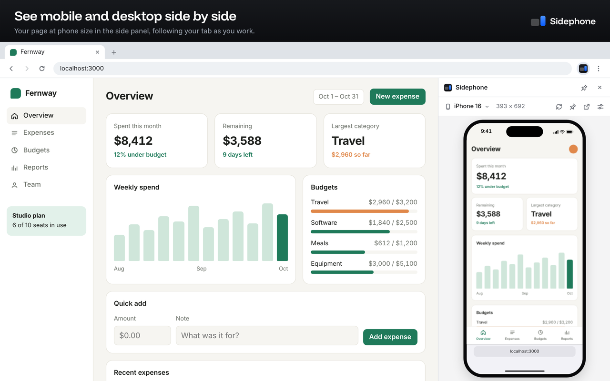

# Sidephone

A Chrome extension that shows the page in your current tab at phone size, in the side panel, while you keep working on the desktop version. It follows the tab as you navigate, so a change that breaks the mobile layout is visible the moment you make it.



It is built for local development: `localhost` works as soon as it is installed. Any other site is off until you turn it on.

## What it does

- **Follows your tab.** The side panel loads whatever page the active tab is on, and reloads when you reload.
- **Real responsive behavior.** The panel holds a second, live copy of the page at the device's width, so CSS media queries, `matchMedia`, `ResizeObserver` and JavaScript-measured layouts all behave as they would at that size.
- **Chrome's device list.** The same devices, groups and screen sizes as the device toolbar in Chrome DevTools.
- **Device frame.** Rounded corners, bezel, camera cutout, status bar and browser bars, so you can see what the browser's own UI leaves for your page.
- **On-screen keyboard.** Focusing a text field draws the phone's keyboard over the page, which shows what it would cover.
- **Mobile checks.** Finds what breaks on a phone and lists it with a count in the toolbar: anything wider than the screen, touch targets under 44px, form fields whose text makes iPhone zoom in, and text too small to read. Click one to scroll to it, or outline them all on the page.
- **JavaScript errors.** Uncaught errors from the mobile copy are listed with the checks, and errors the desktop page did not throw are marked, because those usually come from mobile-only code.
- **Your breakpoints.** Reads the media queries in the page's CSS and shows them under the toolbar. Click one to see the page at exactly that width, or Shift-click for one pixel below it. In Responsive mode, the width grip snaps to them.
- **Single-page apps stay in place.** When your app changes route, the mirror changes route the same way instead of reloading, and keeps its state. Pages that don't react fall back to a reload.
- **Show in Sidephone.** Right-click anything on the desktop page and choose Show in Sidephone to scroll the mobile view to the same element.
- **Compare devices.** Show up to three devices side by side.
- **In-app mode.** Shows the page as it would look inside an app's WebView, without browser bars. On Android devices the page also sees an Android WebView user agent.
- **Scroll sync, pin, rotate, pop out.** Scroll both views together, hold the mobile view on one page, switch orientation, or open the devices in their own window at full size.
- **Remembers your device per site**, so each project opens on the phone you last used with it.
- **Keyboard shortcuts.** Alt+Shift+S opens Sidephone, Alt+Shift+R rotates, Alt+Shift+Comma and Period switch device. Inside the panel: R, [ and ]. Change them at `chrome://extensions/shortcuts`.
- **Real size.** Optionally draw the device at its physical size, calibrated to your monitor.

## Install

From source, with no build step:

1. Clone this repository.
2. Open `chrome://extensions` and turn on **Developer mode**.
3. Click **Load unpacked** and choose the `src` folder.
4. Open a page on `localhost` and click the Sidephone icon in the toolbar.

To mirror a site other than localhost, click the toolbar icon while you are on it. Chrome asks whether to give Sidephone access to that site, and remembers your answer.

## How it works

The side panel contains an `<iframe>` per device that loads the same URL as your active tab. Everything else exists to make those frames behave.

| File                    | Role                                                                                                                                                                             |
| ----------------------- | -------------------------------------------------------------------------------------------------------------------------------------------------------------------------------- |
| `src/panel/panel.js`    | The view: follows the active tab, runs the toolbar, menus, checks and breakpoints. Runs in the side panel and in the pop-out window.                                             |
| `src/panel/view.js`     | One device on the stage: its drawing and the frame holding the page. Checks and caps everything the page sends.                                                                  |
| `src/panel/devices.js`  | Device data and the geometry derived from it. Pure functions, unit tested.                                                                                                       |
| `src/panel/layout.js`   | Fitting several devices side by side, and snapping widths to breakpoints. Pure functions, unit tested.                                                                           |
| `src/panel/keyboard.js` | Markup and sizes for the drawn keyboard.                                                                                                                                         |
| `src/panel/settings.js` | View settings: defaults, validation, persistence in the panel's `localStorage`.                                                                                                  |
| `src/panel/sites.js`    | Helpers around Chrome's host permissions.                                                                                                                                        |
| `src/content/main.js`   | Content script. In a tab it reports scroll position, route changes and errors to a connected view. Inside a view's frame it reports load, colour, focus, checks and breakpoints. |
| `src/content/checks.js` | The mobile checks, breakpoint parsing, and finding the same element in another copy of the page. Read-only.                                                                      |
| `src/content/page.js`   | Runs in the page's own world, the only place uncaught errors can be seen. Also gives a frame the WebView user agent in in-app mode.                                              |
| `src/background.js`     | Service worker. Opens the panel, requests site access, keeps the content scripts registered for granted sites, runs the context menu and shortcuts, removes header rules.        |

Three things about the design are worth knowing before you read the code.

**Sites that forbid framing.** Most real sites send `X-Frame-Options` or a Content-Security-Policy `frame-ancestors` directive. While a mirror view is open, Sidephone installs `declarativeNetRequest` session rules that remove those two response headers, and only for documents loading into a mirror view's frame, on sites it has been granted. Pages in ordinary tabs are never modified. The rules are removed when the last view closes.

`declarativeNetRequest` can remove a header but cannot edit one, so the entire `Content-Security-Policy` header is removed from the mirrored document, not only `frame-ancestors`. The mirrored copy of a page therefore runs without that page's CSP. The page in your tab keeps it.

**Logins.** Chrome treats a frame inside an extension page as same-site when the extension has host permission for that site, so your session cookies are sent and the mirror shows the page as you see it, logged in.

**The frame is sandboxed.** Each iframe has a `sandbox` attribute without `allow-top-navigation`, so a mirrored page cannot replace the view around it. Messages from a frame are only accepted from that frame's own window. The page itself can post to its parent too, so everything received is treated as untrusted: colours are checked with `CSS.supports`, numbers must be finite, text is capped in length and only ever shown as text. Messages carrying anything from your page, such as the element to show, are sent only to that page's origin.

## Permissions

| Permission                                 | Why                                                                                                                               |
| ------------------------------------------ | --------------------------------------------------------------------------------------------------------------------------------- |
| `sidePanel`                                | The mirror lives in the side panel.                                                                                               |
| `activeTab`                                | Clicking the toolbar icon lets the extension see which site the current tab is on, so it can ask for access to exactly that site. |
| `scripting`                                | Registers the content scripts for sites you turn on, and injects them into tabs that were already open.                           |
| `contextMenus`                             | The Show in Sidephone item in the page's right-click menu, on sites Sidephone can mirror.                                         |
| `declarativeNetRequestWithHostAccess`      | The header rules described above. This variant only works on sites the extension has been granted.                                |
| Host access to `localhost` and `127.0.0.1` | The purpose of the extension: local development works with no setup.                                                              |
| Optional host access to other sites        | Requested one site at a time, when you ask to mirror it. Never granted at install.                                                |

Sidephone collects nothing. It makes no network requests of its own, has no analytics and no remote code. See [PRIVACY.md](PRIVACY.md).

## Limitations

- **Two copies of the page.** The mirror is a second page load, not a second view of the same one. Cookies and anything the site persists are shared, but in-memory state is not: text typed into a form or an open dialog in your tab does not appear in the mirror.
- **Route changes.** A single-page app's route change is followed in place when the app's router listens for Back and Forward (`popstate`), as React Router and Vue Router do. Otherwise the mirror reloads at the new URL. Next.js has not been tested.
- **Some sites cannot be mirrored.** A site whose service worker serves its pages from cache bypasses the header rules, and some sites detect framing in JavaScript. For these the view offers to open the page in its own phone-sized window.
- **Width, not hardware.** The mirror has the device's viewport size. It does not emulate touch events, the mobile user agent or the device pixel ratio, so `(hover: none)` and `(pointer: coarse)` still match your desktop. Use Chrome DevTools' device mode or a real phone for those.
- **Chrome's engine.** Every device renders with Chrome. In-app mode on an iPhone shows the layout without browser bars, but not WebKit's behavior; use the iOS Simulator for that. In-app mode on Android sets the user agent seen by the page's JavaScript, not the one sent to the server.
- **Mobile checks are heuristics.** They measure boxes, so a touch target enlarged with a pseudo-element or padding outside the element can still be flagged. Stylesheets from another origin can't be read, so their breakpoints are missing.
- **Approximate device details.** Screen sizes, camera cutouts and safe areas come from Chrome DevTools. Corner radii, bezels, browser bar heights and keyboard sizes are close approximations.
- **Scroll sync follows the page**, not scrollable containers inside it.

## Development

Requires Node 22 or later.

```sh
npm install
npm run lint          # ESLint
npm run format:check  # Prettier
npm test              # unit tests (node:test)
npm run build         # dist/extension and dist/sidephone-<version>.zip
npm run check         # all of the above
```

The source in `src` loads in Chrome as it is. The build only bundles the panel's modules into one file and minifies; it adds no code.

### Tests in a real browser

`tests/browser` loads the extension into Chrome, serves a small test site whose pages forbid framing and set a `SameSite=Lax` cookie, and checks the behavior end to end: header removal, cookies, layout width, the keyboard, breakpoints, scroll sync, navigation including single-page apps, Show in Sidephone, the mobile checks and errors, comparing devices, in-app mode, devices per site, shortcuts, pinning, sites without access, and rule cleanup.

```sh
pip install -r tests/browser/requirements.txt
playwright install chromium
python3 tests/browser/test_extension.py          # tests src/
python3 tests/browser/test_extension.py dist/extension
```

Extensions need a headed browser. On a machine without a display, prefix the command with `xvfb-run -a`.

Some things cannot be automated and need a manual check before a release: opening the real side panel from the toolbar icon, Chrome's permission prompt for a new site, the right-click menu item itself, and Chrome's keyboard shortcuts. The tests send the same messages the last two send.

## License

[MIT](LICENSE)
