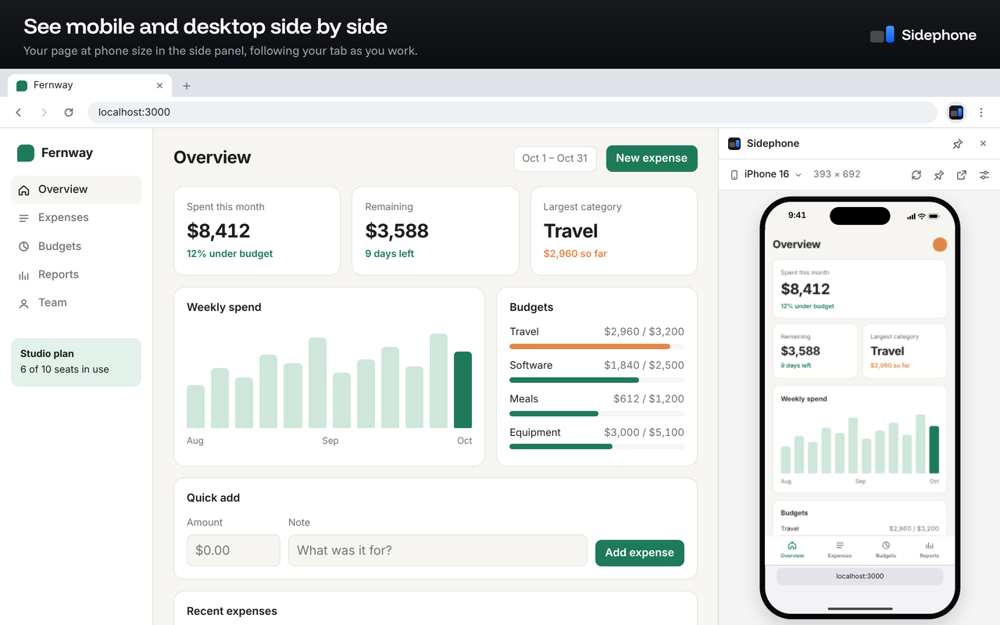

# Sidephone

A Chrome extension that shows the page in your current tab at phone size, in the side panel, while you keep working on the desktop version. It follows the tab as you navigate, so a change that breaks the mobile layout is visible the moment you make it.



It is built for local development: `localhost` works as soon as it is installed. Any other site is off until you turn it on.

## What it does

- **Follows your tab.** The side panel loads whatever page the active tab is on, and reloads when you reload.
- **Real responsive behavior.** The panel holds a second, live copy of the page at the device's width, so CSS media queries, `matchMedia`, `ResizeObserver` and JavaScript-measured layouts all behave as they would at that size.
- **Chrome's device list.** The same devices, groups and screen sizes as the device toolbar in Chrome DevTools.
- **Device frame.** Rounded corners, bezel, camera cutout, status bar and browser bars, so you can see what the browser's own UI leaves for your page.
- **On-screen keyboard.** Focusing a text field draws the phone's keyboard over the page, which shows what it would cover.
- **Scroll sync, pin, rotate, pop out.** Scroll both views together, hold the mobile view on one page, switch orientation, or open the device in its own window at full size.
- **Real size.** Optionally draw the device at its physical size, calibrated to your monitor.

## Install

From source, with no build step:

1. Clone this repository.
2. Open `chrome://extensions` and turn on **Developer mode**.
3. Click **Load unpacked** and choose the `src` folder.
4. Open a page on `localhost` and click the Sidephone icon in the toolbar.

To mirror a site other than localhost, click the toolbar icon while you are on it. Chrome asks whether to give Sidephone access to that site, and remembers your answer.

## How it works

The side panel contains an `<iframe>` that loads the same URL as your active tab. Everything else exists to make that iframe behave.

| File                    | Role                                                                                                                                                                        |
| ----------------------- | --------------------------------------------------------------------------------------------------------------------------------------------------------------------------- |
| `src/panel/panel.js`    | The mirror view: follows the active tab, lays out the device, handles the controls. Runs in the side panel and in the pop-out window.                                       |
| `src/panel/devices.js`  | Device data and the geometry derived from it. Pure functions, unit tested.                                                                                                  |
| `src/panel/keyboard.js` | Markup and sizes for the drawn keyboard.                                                                                                                                    |
| `src/panel/settings.js` | View settings: defaults, validation, persistence in the panel's `localStorage`.                                                                                             |
| `src/panel/sites.js`    | Helpers around Chrome's host permissions.                                                                                                                                   |
| `src/content.js`        | Content script. In a tab it reports the scroll position to a connected view. Inside the mirror frame it reports when the page has loaded, its colour and text-field focus.  |
| `src/background.js`     | Service worker. Opens the panel, requests site access on a toolbar click, keeps the content script registered for granted sites, removes header rules when no view is open. |

Three things about the design are worth knowing before you read the code.

**Sites that forbid framing.** Most real sites send `X-Frame-Options` or a Content-Security-Policy `frame-ancestors` directive. While a mirror view is open, Sidephone installs `declarativeNetRequest` session rules that remove those two response headers, and only for documents loading into a mirror view's frame, on sites it has been granted. Pages in ordinary tabs are never modified. The rules are removed when the last view closes.

`declarativeNetRequest` can remove a header but cannot edit one, so the entire `Content-Security-Policy` header is removed from the mirrored document, not only `frame-ancestors`. The mirrored copy of a page therefore runs without that page's CSP. The page in your tab keeps it.

**Logins.** Chrome treats a frame inside an extension page as same-site when the extension has host permission for that site, so your session cookies are sent and the mirror shows the page as you see it, logged in.

**The frame is sandboxed.** The iframe has a `sandbox` attribute without `allow-top-navigation`, so a mirrored page cannot replace the view around it. Messages from the frame are only accepted from the frame's own window, and the only page-supplied values the view uses are colours, which are checked with `CSS.supports` before they are applied.

## Permissions

| Permission                                 | Why                                                                                                                               |
| ------------------------------------------ | --------------------------------------------------------------------------------------------------------------------------------- |
| `sidePanel`                                | The mirror lives in the side panel.                                                                                               |
| `activeTab`                                | Clicking the toolbar icon lets the extension see which site the current tab is on, so it can ask for access to exactly that site. |
| `scripting`                                | Registers the content script for sites you turn on, and injects it into tabs that were already open.                              |
| `declarativeNetRequestWithHostAccess`      | The header rules described above. This variant only works on sites the extension has been granted.                                |
| Host access to `localhost` and `127.0.0.1` | The purpose of the extension: local development works with no setup.                                                              |
| Optional host access to other sites        | Requested one site at a time, when you ask to mirror it. Never granted at install.                                                |

Sidephone collects nothing. It makes no network requests of its own, has no analytics and no remote code. See [PRIVACY.md](PRIVACY.md).

## Limitations

- **Two copies of the page.** The mirror is a second page load, not a second view of the same one. Cookies and anything the site persists are shared, but in-memory state is not: text typed into a form or an open dialog in your tab does not appear in the mirror.
- **Route changes reload the mirror.** When the tab's URL changes, the mirror navigates to the new URL as a full page load.
- **Some sites cannot be mirrored.** A site whose service worker serves its pages from cache bypasses the header rules, and some sites detect framing in JavaScript. For these the view offers to open the page in its own phone-sized window.
- **Width, not hardware.** The mirror has the device's viewport size. It does not emulate touch events, the mobile user agent or the device pixel ratio, so `(hover: none)` and `(pointer: coarse)` still match your desktop. Use Chrome DevTools' device mode or a real phone for those.
- **Approximate device details.** Screen sizes, camera cutouts and safe areas come from Chrome DevTools. Corner radii, bezels, browser bar heights and keyboard sizes are close approximations.
- **Scroll sync follows the page**, not scrollable containers inside it.

## Development

Requires Node 22 or later.

```sh
npm install
npm run lint          # ESLint
npm run format:check  # Prettier
npm test              # unit tests (node:test)
npm run build         # dist/extension and dist/sidephone-<version>.zip
npm run check         # all of the above
```

The source in `src` loads in Chrome as it is. The build only bundles the panel's modules into one file and minifies; it adds no code.

### Tests in a real browser

`tests/browser` loads the extension into Chrome, serves a small test site whose pages forbid framing and set a `SameSite=Lax` cookie, and checks the behavior end to end: header removal, cookies, layout width, the keyboard, scroll sync, navigation, pinning, sites without access, and rule cleanup.

```sh
pip install -r tests/browser/requirements.txt
playwright install chromium
python3 tests/browser/test_extension.py          # tests src/
python3 tests/browser/test_extension.py dist/extension
```

Extensions need a headed browser. On a machine without a display, prefix the command with `xvfb-run -a`.

Two things cannot be automated and need a manual check before a release: opening the real side panel from the toolbar icon, and Chrome's permission prompt for a new site.

## License

[MIT](LICENSE)
